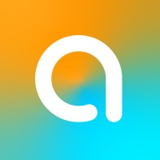
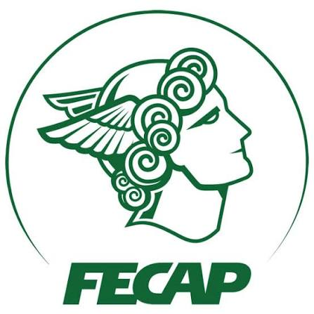

# Olá, eu sou o Paulo Marcelli 👋

**Estudante de Análise e Desenvolvimento de Sistemas na FECAP. Construo com IA:** 
**sistemas com RAG e agentes, automações, landing pages animadas em 3D e jogos.**

## Sobre mim

- 🎓 Curso **Análise e Desenvolvimento de Sistemas (ADS)** na [FECAP](https://www.fecap.br/).
- 💬 Sou **consultor de atendimento trilíngue** (português, inglês e espanhol) na [Apex America](https://apexamerica.com.br/).
- 🍎 Fui **professor de inglês e espanhol** na [Fisk](https://www.fisk.com.br/) por 3 anos.
- 🤖 Gosto de usar IA para construir coisas de verdade: análise com fontes, automações que me poupam tempo e sites que dão vontade de rolar até o fim.
- ✍️ Escrevo no [Substack](https://paulomarcelli.substack.com/) sobre os bastidores dos projetos: o que eu decidi, o que a IA fez e o que deu errado.

## Projetos em destaque

<table>
  <tr>
    <td width="50%" valign="top">
      
      <h3>✨ F.R.E.Y.A.</h3>
      Análise prospectiva com <b>RAG híbrido</b> (Qdrant + Elasticsearch) e <b>GraphRAG</b> no Neo4j: o texto da análise ao lado do grafo que a sustenta. 
      Python · FastAPI · Neo4j · React · TypeScript  
      <a href="https://github.com/paulomarcelli/Projetos/tree/main/Projetos/FREYA"><b>Ver o código ↗</b></a>
    </td>
    <td width="50%" valign="top">
      
      <h3>👁️ Iris</h3>
      Inteligência estratégica em Relações Internacionais: diagnóstico, cenários como hipóteses e sinais a acompanhar, com a fonte de cada afirmação. 
      React · TypeScript · FastAPI · PostgreSQL · em desenvolvimento  
      <a href="https://paulomarcelli.github.io/Projetos/Projetos/Iris/"><b>Abrir a prévia ↗</b></a> · <a href="https://github.com/paulomarcelli/Projetos/tree/main/Projetos/Iris">Código</a>
    </td>
  </tr>
  <tr>
    <td width="50%" valign="top">
      
      <h3>🎯 Caçador de Vagas</h3>
      O <b>n8n</b> lê os alertas de vaga do LinkedIn, a IA dá uma nota para cada vaga e um modelo de <b>Machine Learning</b> aprende o meu gosto e compete com ela. 
      n8n · OpenAI · scikit-learn · Notion API · Python  
      <a href="https://github.com/paulomarcelli/Projetos/tree/main/Projetos/Cacador-de-Vagas"><b>Ver o código ↗</b></a>
    </td>
    <td width="50%" valign="top">
      
      <h3>🌙 LUNA MIND</h3>
      Assistente de apoio emocional por texto e voz, publicada, com RAG com fontes e uma camada de segurança em código. 
      Python · Flask · OpenAI · Gemini  
      <a href="https://paulomarcelli.github.io/Projetos/Projetos/Luna/"><b>Abrir a Luna ↗</b></a> · <a href="https://github.com/paulomarcelli/Projetos/tree/main/Projetos/Luna-AI">Código</a>
    </td>
  </tr>
  <tr>
    <td width="50%" valign="top">
      
      <h3>📱 Karol × Samsung</h3>
      Um Galaxy S26 Ultra <b>desenhado em código</b> a partir das medidas públicas: ele se desmonta em seis camadas, mergulha na lente e vira câmera. 
      Three.js · GSAP · Vite · projeto pessoal de fã  
      <a href="https://paulomarcelli.github.io/Projetos/Projetos/Karol-x-Samsung/"><b>Abrir o site ↗</b></a> · <a href="https://github.com/paulomarcelli/Projetos/tree/main/Projetos/landing%20page%20Karol%20Sevilla%20x%20Samsung">Código</a>
    </td>
    <td width="50%" valign="top">
      
      <h3>🌀 Portfólio</h3>
      O scroll entra num túnel 3D com as telas dos projetos, e os cases saem da parede. 
      Three.js · GSAP · Vite  
      <a href="https://paulomarcelli.github.io/Projetos/Projetos/Portfolio/"><b>Abrir o portfólio ↗</b></a> · <a href="https://github.com/paulomarcelli/Projetos/tree/main/Projetos/Portfolio">Código</a>
    </td>
  </tr>
  <tr>
    <td width="50%" valign="top">
      
      <h3>🌙 Una Noche Más</h3>
      Um site de fã que eu tinha feito à mão, refeito com IA sem perder a identidade: a mesma paleta e os mesmos textos, agora como uma colagem noturna. A versão original continua no ar. 
      HTML · CSS · JavaScript  
      <a href="https://paulomarcelli.github.io/Projetos/Projetos/Una-Noche-Mas/"><b>Nova ↗</b></a> · <a href="https://paulomarcelli.github.io/Projetos/Projetos/Una-Noche-Mas/classic/">Original</a> · <a href="https://github.com/paulomarcelli/Projetos/tree/main/Projetos/Una-Noche-Mas">Código</a>
    </td>
    <td width="50%" valign="top">
      
      <h3>🏹 Aurora: O Dízimo da Lua</h3>
      Jogo de plataforma em desenvolvimento: a personagem respira, pisca e tem o cabelo levado pelo vento; física de pulo calculada e fogueiras para evoluir. 
      PixiJS · JavaScript · arte gerada com IA  
      <a href="https://paulomarcelli.github.io/Projetos/Projetos/Aurora/"><b>Jogar o protótipo ↗</b></a> · <a href="https://github.com/paulomarcelli/Projetos/tree/main/Projetos/Aurora-Jogo">Código</a>
    </td>
  </tr>
</table>

<a href="https://github.com/paulomarcelli/Projetos"><b>Ver todos os projetos →</b></a>

## Últimos posts no Substack

<!-- SUBSTACK:START -->
- [Eu não baixei esse celular: desenhei um Galaxy S26 Ultra inteiro em código](https://paulomarcelli.substack.com/p/eu-nao-baixei-esse-celular-desenhei)
- [Uma IA consegue aplicar Gestalt?](https://paulomarcelli.substack.com/p/uma-ia-consegue-aplicar-gestalt)
- [Dá para confiar numa IA quando o assunto é saúde mental?](https://paulomarcelli.substack.com/p/da-para-confiar-numa-ia-quando-o)
<!-- SUBSTACK:END -->

A lista se atualiza sozinha todo dia, a partir do feed do Substack.

## O que eu uso

**IA e dados** 

**Web e 3D** 

**Jogos, banco de dados e ferramentas** 

-F29111?style=flat-square&logo=oracle&logoColor=white)

## Formação e experiência

| | Onde | Quando |
| --- | --- | --- |
| Consultor de atendimento trilíngue (português, inglês e espanhol) | [Apex America](https://apexamerica.com.br/) | **Atual** |
| Análise e Desenvolvimento de Sistemas | [FECAP](https://www.fecap.br/) | Em andamento |
| Professor de inglês e espanhol | [Fisk](https://www.fisk.com.br/) | 3 anos |

  
  
  

**Idiomas:** 🇧🇷 português (nativo) · 🇺🇸 inglês (fluente) · 🇪🇸 espanhol (fluente)

## No GitHub

  

  <picture>
    <source media="(prefers-color-scheme: dark)" srcset="https://raw.githubusercontent.com/paulomarcelli/paulomarcelli/output/github-contribution-grid-snake-dark.svg" />
    <source media="(prefers-color-scheme: light)" srcset="https://raw.githubusercontent.com/paulomarcelli/paulomarcelli/output/github-contribution-grid-snake.svg" />
    
  </picture>

Obrigado pela visita! Se algum projeto te interessou, me chama no <a href="https://www.linkedin.com/in/paulo-marcelli-06a7bb304/">LinkedIn</a>.

